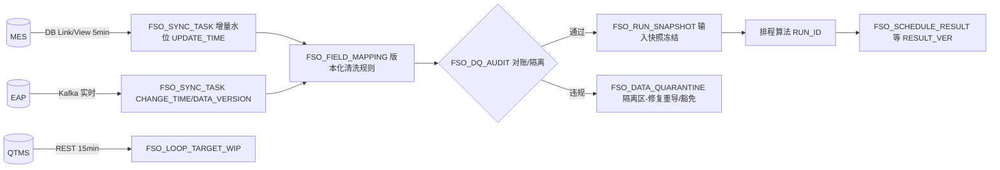
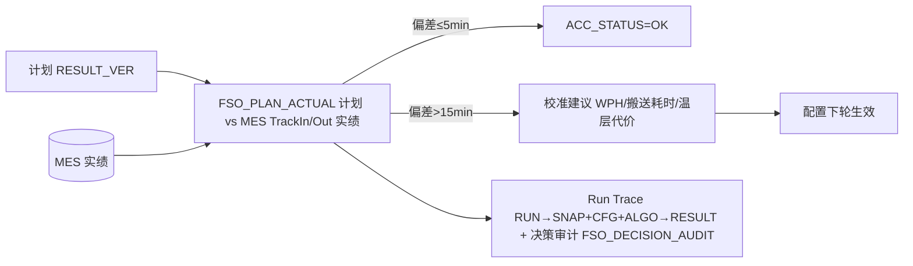

# GTX FSO Litho · 数据流转 v1

> 依据：设计书 §2/§3/§4/§6 + 《数据库表设计_v1.md》（表名/字段以该文档为权威）+ 原型 7 分区文件
> 日期：2026-10-25

## 1. 全链路数据流图

```
【客户侧系统】                    【FSO 数据层 SOURCE_*】              【算法层】                       【结果与联动】
MES ──Lot/Flow/QTime──→  SOURCE_LOT / SOURCE_PRODUCT_FLOW ─┐
MES(历史) ────────────→  LOTHIST                          ├→ ① 预处理 ─→ ② Reticle预组批(MILP)
RTD/设备 ──机台状态──→   SOURCE_EQP_INFO / EQP_STATUS      │              └→ ③ Lot细排程(MILP) ─→ FSO_SCHEDULE_RESULT
                         SOURCE_EQP_CHAMBER_STATUS         │                    │
设备 ──Recipe────────→  SOURCE_EQP_RECIPE                 │                    ├→ ④ 后处理 ─→ FSO_RETICLE_TRANSPORT_CMD ──→ SDR（两方案下发）
AMHS/光罩柜 ──光罩──→   SOURCE_RETICLE_STATUS(实时)       │                    ├→ ⑤ BARC反推 ─→ BARC_RELEASE_BATCH ──→ BAC 下货
                         (隐含)SOURCE_RETICLE_INFO         │                    └→ ⑥ 光罩状态推演
MES(APC/Stacking/Doma)→  FSO_STACKING_LAYER_GROUP          │                          └→ EARLIEST_AVAILABLE_* 回写 + QTMS 水位标记
                                                            └── FSO_LOOP_TARGET_WIP（水位基准）
```

## 2. 分段流转说明

### 2.1 入库段（SOURCE_* → 预处理）
- SOURCE_LOT（31 字段）提供 Lot 当前站位/片数/优先级/Reticle 绑定；SOURCE_PRODUCT_FLOW（37 字段）提供完整工艺路径与 LAYER。
- SOURCE_EQP_STATUS.RUNNING_LOTS/JOB_PREPARE_LOTS 直接支撑 Scanner Chart 的 Running/Jobprepare/Scheduling 三态条。
- 光罩侧：SOURCE_RETICLE_STATUS（实时）推算 EARLIEST_AVAILABLE_TIME/LOCATION，作为推演起点；阈值主数据在（隐含表）SOURCE_RETICLE_INFO。
- 配置：FSO_CFG_PARAM 承载 Bullet/Reticle 9 参数/Process 4 参数/Fix Lot/排程参数（max_step/time_limit 等）。

### 2.2 排程段（算法内部）
- ② Reticle 预组批输出 Lot-Reticle-机台分配 → ③ 以 chunk≤50 细排 → 产出 FSO_SCHEDULE_RESULT（EQP_ID/SEQ/LOT_ID/RETICLE_ID/PROCESS_START/END/STEP_SEQ/STAGE/EQP_GROUP/PRODUCT...）。
- QTMS：③ 结果按 FSO_LOOP_TARGET_WIP 的 TARGET/ACTUAL/REMAIN/RESERVED_WIP 判定超水位 → Scanner Chart 红框标记。

### 2.3 出参与联动段
- **SDR**：④ 后处理生成 FSO_RETICLE_TRANSPORT_CMD（Job Type：Clean/IRIS/StarLight/N2 Purge/Load/Unload/Move）。方案一仅下发 [T1,T2] 时间窗+Reticle List；方案二由后处理定时刻提前 1~3h 下发即搬（send_status 追踪）。**接口协议待需求方确认（缺口 D8）**。
- **QTMS**：超水位标记 + 水位页面展示（FSO_LOOP_TARGET_WIP）。
- **MES**：BARC_RELEASE_BATCH 回传 BAC 下货；LOTHIST 持续回流用于上游 CycleTime 与 WPH 统计。
- **BAC**：Barc Schedule 页签 12 列即 BARC_RELEASE_BATCH + FSO_SCHEDULE_RESULT 联查（Reason 来自 ERROR_MESSAGE 同源算法信息）。

## 3. 页面数据供给（摘要，完整映射见 DB 设计 §5）
| 页面 | 查询链 |
|---|---|
| Scanner Schedule-Chart | FSO_SCHEDULE_RESULT ⨝ SOURCE_EQP_STATUS（三态）⨝ FSO_LOOP_TARGET_WIP（红框） |
| Reticle Schedule-Chart | SOURCE_RETICLE_STATUS ⨝ FSO_SCHEDULE_RESULT（五态色块） |
| Reticle Transport | FSO_RETICLE_TRANSPORT_CMD（当日按 EXPECT_USE_TIME 排序 + SVG 路径） |
| Scheduling Log | FSO_LOG_SCHEDULING（每次模型运行一行；Error/Abnormal 带 query 跳 FSO_LOG_ERROR） |
| Litho OverLap / Wafer 加工时间 | ⚠ 缺口 C 级：客户源表 12 列表头/整表数据空白，页面做警示占位，待需求方确认（D8 关联） |

## 4. 数据一致性要点
- 急货故事线 LOT-A01 + RT-0101 在 SOURCE_LOT → FSO_SCHEDULE_RESULT → FSO_RETICLE_TRANSPORT_CMD → BARC_RELEASE_BATCH 全链贯通（原型 mock 同口径：09:10 IRIS 20min → 09:30 搬送 10min → 09:45 就绪 → 10:00 加工 25 片）。
- 乐观锁：SOURCE_RETICLE_STATUS.DATA_VERSION；逻辑删除 IS_DELETE 全表统一。
- 时间口径：DATE 秒级；"相对秒"仅推演内部计算，落库转绝对时间。

## 5. MES 接入与实绩回流链路（2026-10-25 增：data_zone + 溯源闭环）

### 5.1 接入链（入站）

要点：①对账不通过/隔离未处置的数据不进快照；②快照即「数据水位证明」；③映射改版本不即时生效（随全量刷新切换，保证与快照可对账）。

### 5.2 回流链（出站闭环）


### 5.3 反查（溯源）四问与答案路径
| 问题 | 答案路径 |
|---|---|
| 这次排程用了哪批数据？ | RESULT_VER → RUN_ID → FSO_RUN_SNAPSHOT.SNAP_ID → 对账批次 RC-*（FSO_DQ_AUDIT） |
| 为什么这个 Lot 排这台机？ | FSO_DECISION_AUDIT.reason_code + 评分因子 + 约束命中（可按快照重放 Replay 验证算法未变） |
| 中间结果对不对？ | result_litho?page=mid 六步产物逐行溯源（04_DB §4.8 MID 三表，CHECK 6/6 PASS） |
| 计划准不准？ | FSO_PLAN_ACTUAL 偏差分布 + 校准建议闭环（回流进下一轮配置） |

> 接入与溯源的界面载体：`data_zone.html`（数据源管理/同步任务监控/字段映射/数据质量对账 4 页签）、`log_zone.html` Run Trace 页签、`result_litho.html?page=plan`（计划 vs 实际）；接口见 05_API §5.4/§5.5，表见 04_DB §4.9/§4.10。
